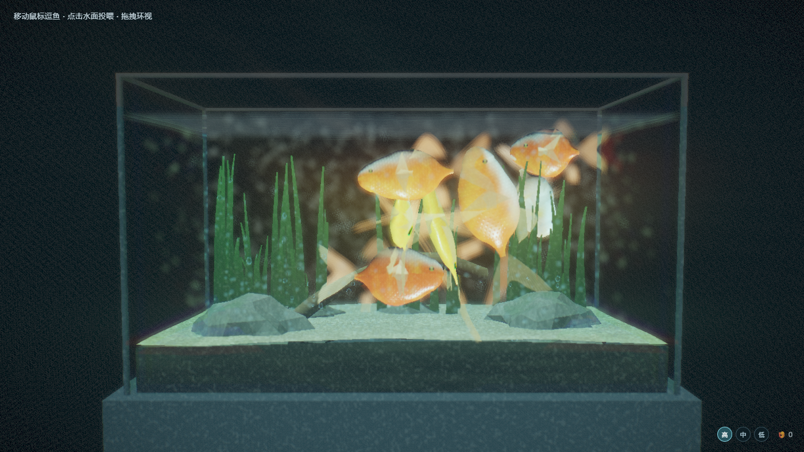

# Aquarium

一个可交互的超写实 3D 金鱼水族箱：鼠标逗鱼、点击投喂，光影与动态细节拉满。
纯程序化生成，仓库内没有任何图片/模型资源。



## 玩法

- **移动鼠标** —— 鱼会被光标吸引，靠近后会侧身打量你
- **快速划动** —— 像掠过的阴影，鱼群会受惊散开
- **点击水面** —— 撒下鱼食，激起涟漪；鱼会冲上来抢食
- **拖拽** —— 绕缸环视
- **右下角** —— 切换高/中/低画质

饥饿度会随时间上升：吃饱的鱼游得慢、爱贴着缸底晃；饿了的鱼会主动追食。

## 技术要点

全部手写 GLSL，无外部美术资源。

| 模块 | 做法 |
|---|---|
| 焦散 | 迭代 sin 折叠算法渲染到 RT，按世界坐标投影到沙床/石头/鱼背 |
| 水体 | 屏幕空间 Beer-Lambert 分通道吸收 + 内散射 + 深度衰减 |
| 玻璃 | 独立面板最后叠加：偏移采样做折射、菲涅尔反射、缸口亮边 |
| 水面 | 顶点波浪 + CPU 波动方程涟漪场，回写 DataTexture |
| 鱼 | 程序化网格 + 顶点着色器行波摆尾 + 鳞片法线/虹彩/SSS 近似 |
| 后处理 | 线性化景深、God rays、mip 链泛光、ACES、色差、颗粒 |

详见 [docs/PLAN.md](docs/PLAN.md)，开发过程与踩坑记录见 [docs/DEVLOG.md](docs/DEVLOG.md)。

## 开发

```bash
npm install
npm run dev        # http://localhost:5173
npm run build      # 类型检查 + 生产构建
npm run shot       # 无头截图（需本机 Chrome）
node tools/interact.mjs   # 交互闭环测试
```

调试参数：`?debug=plain|base|nofx|nodof|u1|u2`

## 兼容性

需要 WebGL2。目标为桌面 Chrome / Edge / Firefox 最新版，1080p 高画质。

## 部署

推送到 `main` 后由 GitHub Actions 构建并发布到 GitHub Pages。
